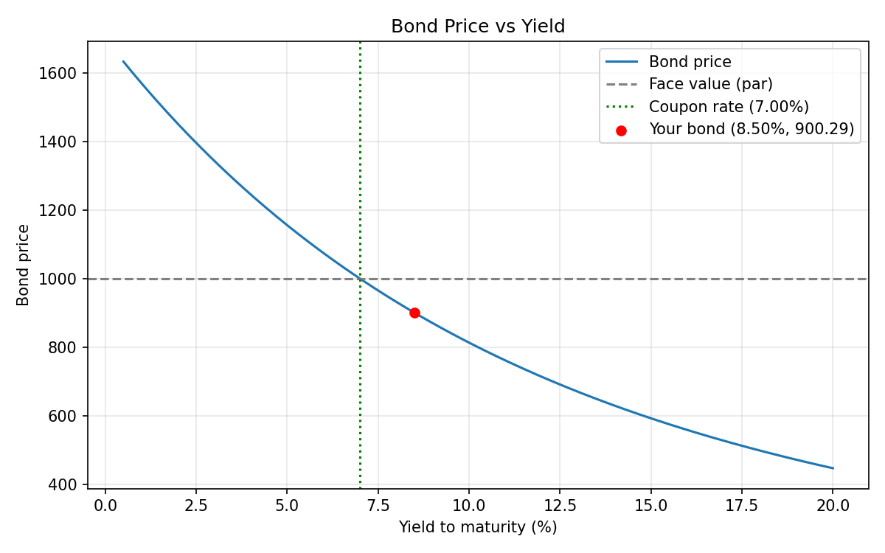

# Bond Pricing & Yield Calculator

A small Python command-line tool that prices a bond, solves for its yield to maturity (YTM), and shows how bond prices move when interest rates change. Built while studying **Bonds: characteristics and valuation** in my BFSI course 

## The finance idea

A bond's price is the **present value of its future cash flows**: the periodic coupon payments plus the face value returned at maturity, discounted at the market yield.

```
Price = Σ  C / (1 + y/f)^t   +   F / (1 + y/f)^n
        t=1..n
```

`F` = face value, `C` = coupon per period, `y` = annual yield, `f` = payments per year, `n` = total periods.

The key relationship: **when yields rise, bond prices fall (and vice versa)**. The plot below shows this.



## Features

- Bond price from a given yield
- Yield to maturity from a given market price (solved with the bisection method)
- Current yield
- Premium / discount / par classification
- Macaulay and modified duration (sensitivity of price to yield changes)
- Price vs yield plot (shown on screen or saved as an image)
- Input validation and unit tests

## Setup

```bash
git clone https://github.com/suhithareddy07/bond-pricing-calculator.git
cd bond-pricing-calculator
pip install -r requirements.txt
```

Only the plot needs `matplotlib`. The calculations use plain Python.

## Usage

**Price a bond from its yield** (face 1000 by default, 7% semi-annual coupon, 10 years, 8.5% market yield):

```bash
python bond_calculator.py --coupon 7 --years 10 --ytm 8.5
```

```
=== Bond Summary ===
Face value         : 1,000.00
Coupon rate        : 7.00% (2x per year)
Years to maturity  : 10.0
Yield to maturity  : 8.5000%
Price              : 900.29
Trading at         : discount
Current yield      : 7.7753%
Macaulay duration  : 7.1915 years
Modified duration  : 6.8983
```

**Find the YTM from a market price:**

```bash
python bond_calculator.py --coupon 7 --years 8 --price 950
```

**Plot price vs yield:**

```bash
python bond_calculator.py --coupon 7 --years 10 --ytm 8.5 --plot
python bond_calculator.py --coupon 7 --years 10 --ytm 8.5 --save-plot price_vs_yield.png
```

### Options

| Flag | Meaning | Default |
|------|---------|---------|
| `--face` | Face (par) value | 1000 |
| `--coupon` | Annual coupon rate in % | required |
| `--years` | Years to maturity | required |
| `--freq` | Coupon payments per year (1, 2, 4, 12) | 2 |
| `--ytm` | Market yield in % (computes price) | one of `--ytm` / `--price` |
| `--price` | Market price (computes YTM) | one of `--ytm` / `--price` |
| `--plot` / `--save-plot FILE` | Show or save the plot | off |

## Using it as a library

```python
from bond_calculator import bond_price, yield_to_maturity

bond_price(1000, 0.05, 0.06, 10, freq=2)          # 925.61
yield_to_maturity(1000, 0.05, 925.61, 10, freq=2) # ~0.06
```

## Tests

```bash
pytest
```

Tests check, among other things, that a bond with coupon rate equal to yield prices at par, that a known textbook case gives 925.61, that prices fall as yields rise, that YTM recovers the yield used to price a bond, and that a zero-coupon bond's duration equals its maturity.

## How YTM is solved

There is no closed-form formula for YTM, so the code uses **bisection**. Because price decreases as yield increases, it repeatedly halves a yield interval until the computed price matches the market price.

## Limitations

This is an educational model. It assumes whole coupon periods, ignores accrued interest, day-count conventions, taxes, and credit risk, and is not investment advice.

## Possible extensions

- Accrued interest and clean vs dirty price
- Convexity
- Yield curve visualisation
- A bond portfolio summary

## License

MIT
